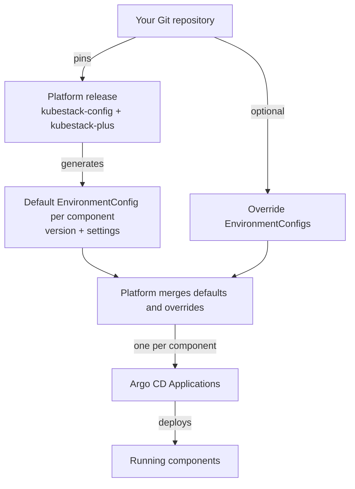

# Versioning and Upgrades

How SCO is versioned, how you upgrade it through Git, and how you see exactly
which versions run on your cluster.

SCO is not a single program. Like the larger OpenShift add-ons, such as
OpenShift Virtualization, it is a set of components (Crossplane, Argo CD, the
identity provider, the secret store, KCP and many more) configured to work
together. A **platform release** is one tested set of versions for those
components, together with the configuration that connects them.

You decide which release runs, when it changes, and whether any single component
deviates from it. Every component is pinned to a fixed version, and every pin
is observable in the cluster, so you can always read exactly what runs (see
[See What Is Running](#see-what-is-running)). The operators that SCO installs
are set to manual update approval, so the platform does not move to a new
version by itself.

---

## What a Platform Release Is

A platform release is identified by the versions of two packages:

| Package | Contains |
|---|---|
| `kubestack-config` | The version and default settings of every platform component, including Crossplane itself, its providers and functions, and Argo CD |
| `kubestack-plus` | The logic that turns those versions and settings into one Argo CD `Application` per component |

Each package is installed as a Crossplane `Configuration` with a fixed version
tag. Stakater tests the two versions together, and tests the component versions
that `kubestack-config` carries against each other. That pair of tags is the
version of your platform.



For each component, `kubestack-config` generates an `EnvironmentConfig` that
holds the component's chart version and its settings. `kubestack-plus` reads
these and creates the Argo CD `Application` for the component at exactly that
version. Argo CD then deploys the component's chart from the Stakater
distribution registry and keeps it in that state.

!!! note "Child clusters on the `hosting` variant"
    On `hosting`, the base components that the platform installs on the clusters
    it provisions take their versions from `kubestack-plus` directly. They
    change with the platform release, not through an override.

The packages and charts in the distribution registry do not change after they
are published, so the same release tags always select the same charts. The
container images that a chart runs are named by that chart, and some of them
come from the registry of the component's own vendor or project, not from the
distribution registry.

## What You Control

| Level | What it sets | Where you set it |
|---|---|---|
| Platform release | The tested set of all component versions | The two `Configuration` version tags, in Git |
| Individual components | The version or settings of any component you choose, in place of the release default | An override `EnvironmentConfig` per component, in Git |
| Component selection | Whether a component is installed at all | `excludedAddons` in the `KubeStackPlus` claim |

The release is the default, not a restriction. You can stay on a release for as
long as you choose, hold one component back while the rest moves forward, or
move one component ahead of the release. Every such choice is a file in your
repository, and the cluster shows it.

What you take on with an override is the testing. Stakater tests the release as
a set. A component version you choose yourself is a combination that you
verify.

## Where `ksp up` Fits

Argo CD and Crossplane reconcile the platform, but something has to install
Argo CD and Crossplane first. `ksp up` does that once. It installs Crossplane,
its functions, Argo CD and the two release packages, creates the registry
credentials and install secrets, and applies your two claims. See
[OpenShift Installation](openshift.md).

After that, the platform manages itself:

- Argo CD takes over the components that `ksp up` installed, Crossplane and
  Argo CD included, and moves them to the versions of the platform release.
- **Running `ksp up` again does not upgrade anything.** Each `ksp` version
  installs one fixed platform release and has no option to choose another. On
  a cluster that is already installed, it reports that the cluster is complete
  and changes nothing.
- Upgrades and configuration changes are made in Git, as described below.

Three things that `ksp up` creates stay outside this loop until you put them in
Git:

| Created by `ksp up` | To manage it yourself |
|---|---|
| The two release `Configuration` objects | Add them to your repository. See [Manage the Release in Git](#manage-the-release-in-git) |
| The `KubeStackConfig` and `KubeStackPlus` claims | Export them from the cluster and commit them in the same place |
| Registry credentials and install secrets | Keep them in your own secret management. `ksp up` does not rotate them |

To run the first installation from a pipeline, add `--no-prompt`. The machine
that runs it needs `helm` and `kubectl` as well as `ksp`. `ksp up` can finish
successfully before the claims are ready, so follow it with `ksp status`.

## Manage the Release in Git

After installation, the two `Configuration` objects exist on the cluster but not
in your repository. Add them once. From then on, the version of your platform is
a line in a file that you review and merge.

### Step 1: Export the two packages

```bash
oc get configuration.pkg.crossplane.io package-ksp-system-kubestackconfig -o yaml > configuration-kubestack-config.yaml
oc get configuration.pkg.crossplane.io package-ksp-system-kubestackplus  -o yaml > configuration-kubestack-plus.yaml
```

Remove `status` and the generated `metadata` fields (`uid`, `resourceVersion`,
`creationTimestamp`, `generation`, `managedFields`). The main fields of each
file then look like this; your export can carry more `spec` fields:

```yaml
apiVersion: pkg.crossplane.io/v1
kind: Configuration
metadata:
  name: package-ksp-system-kubestackconfig
spec:
  package: ghcr.io/stakater/registry/xpackage/kubestack-config:<version>
  packagePullSecrets:
    - name: crossplane-registry-pull-secret
  skipDependencyResolution: true
```

Keep the `package` path and every `spec` field exactly as exported. Only the
version tag changes later.

### Step 2: Commit them with your claims

Export the two claims from the cluster in the same way, and clean them up the
same way:

```bash
oc get kubestackconfig <cluster-name> -n ksp-system -o yaml > kubestack-config-claim.yaml
oc get kubestackplus <cluster-name>-ocp-<variant> -n ksp-system -o yaml > kubestack-plus-claim.yaml
```

Use the exported claims, not the files you passed to `ksp up`. The installer
can add values during installation, such as `openshiftVersion`, that your
original files do not contain.

```text
<cluster-name>/
├── platform/
│   ├── configuration-kubestack-config.yaml
│   ├── configuration-kubestack-plus.yaml
│   ├── kubestack-config-claim.yaml
│   └── kubestack-plus-claim.yaml
└── env-overrides/
    └── <component>.yaml
```

### Step 3: Let Argo CD sync them

Give Argo CD read access to your repository, then apply this Application once.
If your Argo CD instance runs in a namespace other than `openshift-gitops`, use
that namespace here and in the commands further down.

```yaml
apiVersion: argoproj.io/v1alpha1
kind: Application
metadata:
  name: platform-release
  namespace: openshift-gitops
spec:
  project: default
  source:
    repoURL: <your-git-repository>
    targetRevision: main
    path: <cluster-name>/platform
  destination:
    server: https://kubernetes.default.svc
  syncPolicy:
    automated:
      selfHeal: true
```

Leave `prune` off for this Application, so that removing a file from Git can
never remove a release package from the cluster. Create a second Application
for `<cluster-name>/env-overrides` in the same way; that one can prune.

Use `syncPolicy.automated` if a merge should roll out immediately. Leave it out
if you want a person to start each sync in Argo CD after the merge. Before the
first sync, check in Argo CD that the Application shows no differences against
the cluster: at this point Git should only describe what already runs.

!!! warning "Do not uninstall the `ksp-system` Helm release"
    `ksp up` installed the two packages through a Helm release named
    `ksp-system`. Leave that release in place. Uninstalling it removes the
    packages, and the platform with them. The release is static, so it does not
    conflict with Argo CD managing the same two objects.

## Upgrade to a New Release

An upgrade is a pull request that changes the two version tags.

1. **Choose the release.** Use a `kubestack-config` and `kubestack-plus` pair
   that Stakater has released together.
1. **Raise a pull request** that changes the tags in
   `configuration-kubestack-config.yaml` and `configuration-kubestack-plus.yaml`.
1. **Review and merge** through your normal process.
1. **Sync.** Argo CD applies the new tags. Crossplane installs the new package
   revisions, and the platform updates each component whose version changed in
   the release.
1. **Verify**, as described in [See What Is Running](#see-what-is-running).

!!! tip "Move one minor version at a time"
    Do not skip several `kubestack-config` minor versions in one change. A newer
    release can expect component versions that a much older one has not yet
    rolled out. Upgrade a non-production cluster first.

### Hold a component back during an upgrade

If one component must not change in an upgrade, for example because you want to
move it in a separate maintenance window, pin it first:

1. Add an override that pins the component to the version it runs now (see the
   next section), and merge it.
1. Upgrade the release in a separate change. The pinned component stays where
   it is while everything else moves.
1. Later, raise the version in the override, or delete the override to return
   the component to the release default.

## Control Component Versions Yourself

You do not have to take a component's version from the platform release. To set
it yourself, add an override `EnvironmentConfig` for that component. Your
version then applies in place of the release default, for one component or for
as many as you choose. This example pins the `stakater-reloader` component on a
`scobasic` installation:

```yaml
apiVersion: apiextensions.crossplane.io/v1beta1
kind: EnvironmentConfig
metadata:
  name: <cluster-name>-stakater-reloader-addon-env-override
  labels:
    kubestack.stakater.com/addon-name: stakater-reloader
    kubestack.stakater.com/config-kind: kubestack-plus-env
    kubestack.stakater.com/config-scope: addon
    kubestack.stakater.com/domain: <apps-domain>
    kubestack.stakater.com/name: <cluster-name>
data:
  SCOBASIC-OCP-VERSION: "<chart-version>"
```

The parts that matter:

| Part | Rule |
|---|---|
| `config-scope: addon` label | Required. The platform only reads `EnvironmentConfig` objects that carry it |
| `addon-name` label | Required. The component the override applies to |
| `metadata.name` | Must sort after the default, which is named `<cluster-name>-<component>-addon-env`. Adding `-override` to that name does this |
| `<VARIANT>-OCP-VERSION` | The chart version to run. The prefix is your variant in upper case: `SCOBASIC` or `HOSTING` |
| `<VARIANT>-OCP-VALUES` | Optional. Settings to change, as described in [Platform Configuration](configuration.md#customising-platform-configuration) |

An override contains only what you change. Leave out the `VALUES` key and the
component keeps the settings of the release; settings you do include are merged
over the defaults. The version is not merged: the override's version replaces
the default.

To find the component names and their current versions, see
[Component versions](#component-versions) below.

!!! note "An override stays until you remove it"
    A version override also applies after later upgrades. If a newer release
    raises that component's default past your pinned version, the override now
    holds the component back. Record in the file why the override exists, and
    delete it when the release default reaches the version you need.

!!! note "The chart version must be in the distribution registry"
    The registry carries the chart versions Stakater has released to customers.
    If the version you need is not there, ask Stakater to publish it.

## See What Is Running

Everything above is visible on the cluster. These commands only read.

### Platform release

```bash
oc get configuration.pkg.crossplane.io \
  -o custom-columns=NAME:.metadata.name,PACKAGE:.spec.package
```

The two tags are your platform release. To confirm that an upgrade has
finished, check that the new revision of each package is active and healthy:

```bash
oc get configurationrevision.pkg.crossplane.io
```

### Component versions

The version each component is set to, after overrides:

```bash
oc get applications.argoproj.io -n openshift-gitops \
  -l kubestack.stakater.com/addon-name \
  -o custom-columns=COMPONENT:.metadata.name,VERSION:.spec.source.targetRevision,SYNC:.status.sync.status,HEALTH:.status.health.status
```

`VERSION` is the version Argo CD has been told to run. `Synced` and `Healthy`
confirm that this version is what is deployed.

### Release defaults and your overrides

```bash
# Every default and override, with the version each one sets
oc get environmentconfigs -l kubestack.stakater.com/config-scope=addon \
  -o custom-columns=NAME:.metadata.name,COMPONENT:.metadata.labels.kubestack\\.stakater\\.com/addon-name,VERSION:.data.SCOBASIC-OCP-VERSION

# Only the overrides
oc get environmentconfigs -l kubestack.stakater.com/config-scope=addon -o name | grep override
```

Replace `SCOBASIC` with `HOSTING` on a `hosting` installation. A component
whose version differs between its `-addon-env` and `-addon-env-override` rows
is one you have moved away from the release.

### Crossplane packages

```bash
oc get providers.pkg.crossplane.io,functions.pkg.crossplane.io
```

### Health

```bash
ksp status
```

`ksp status` reports whether the claims and components are synced and healthy.
It does not print versions; use the commands above for those.

## What's Next?

- [Platform Configuration](configuration.md) - Change component settings with overrides
- [Prerequisites](prerequisites.md#kubestack-cli-ksp) - Supported `ksp` versions
- [OpenShift Installation](openshift.md) - The first installation with `ksp up`
